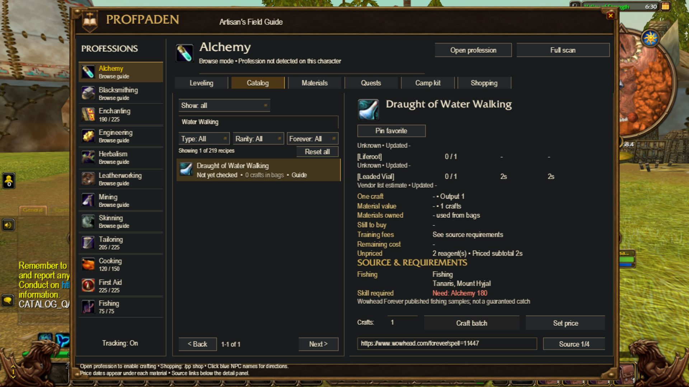
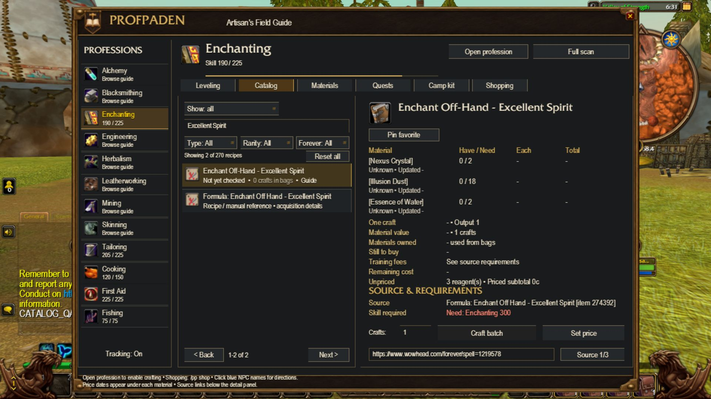
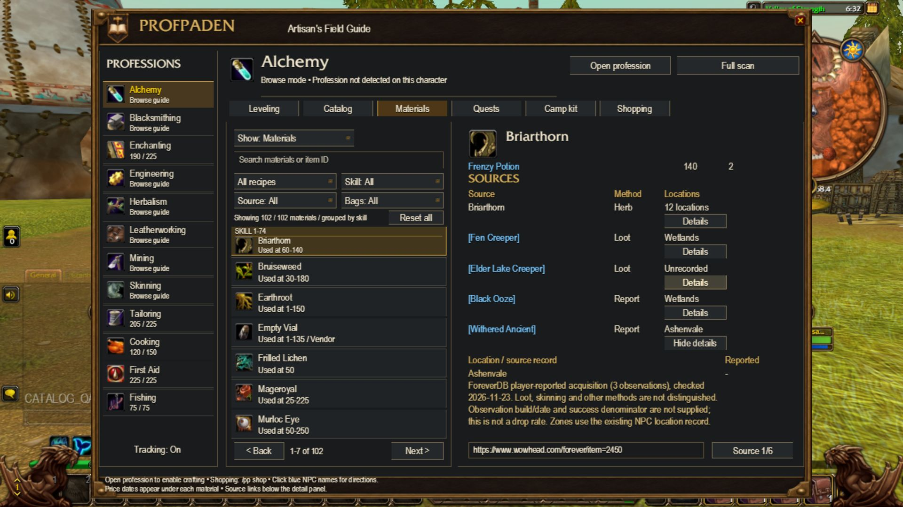

# November 23 catalog review - 0.20.40-rc1

## Coverage and changes

Refreshed 141 public ForeverDB datasets: 12 profession catalogs, the full item index, 64 acquisition shards and 64 vendor shards. All requests succeeded; fetch times, URLs and SHA-256 hashes are in [fetch-provenance.json](fetch-provenance.json). This is a current retrieval, not a claim that every underlying observation was collected on November 23.

The audit includes every one of the 2,495 installed spell recipes, all 2,494 provider recipes and all 4,401 item IDs referenced by item metadata, items, recipe outputs, reagents or teaching books. The 79 catalog entries without spell IDs remain unchanged; their item IDs are included. All 2,492 shared recipes have exactly matching reagent identities and quantities. Three installed-only spell records are retained: absence from this provider is not removal evidence. The full item index is byte-identical to the November 22 snapshot; acquisition/vendor observations changed.

- 1,303 source links across 200 items: 977 repeated acquisition reports and 326 observed vendor records.
- 514 trainer links across 329 recipes, resolved by unique exact NPC name and existing location.
- Three teaching-book links: Water Walking, Superior Intellect off-hand and Excellent Spirit off-hand. Water Walking now has the published Alchemy 180 requirement.
- Three current names: Gray Leather Boots, Mender's Mail Shoulders and Skycaller's Mail Shoulders. The current Gray Leather Boots page agrees with the retained 75/100/112/125 skill thresholds, clearing the older conflicting note.

[Summary](summary.json), [every recipe](recipe-ledger.json), [every item](item-ledger.json), [reviewed additions](reviewed.json), [accepted raw observations](accepted-observations.json), [held item candidates](held-item-candidates.json).

## Evidence and exclusions

Acquisition reports require a current Forever item, at least three observations, and an exact existing NPC ID/name/location match. They remain `Report`, with no invented loot/skinning distinction, drop rate, spawn coordinate or collection date. Vendor reports require an exact known NPC/zone match, and remain subject to live faction, reputation and stock conditions. No prices are bundled. Mister Graphed's ambiguous stock remains excluded from this bulk refresh. Existing acquisition records and conditions remain intact.

Primary recipe evidence:

- [Recipe: Draught of Water Walking](https://www.wowhead.com/forever/item=288206/recipe-draught-of-water-walking): teaching relationship, Alchemy 180, published fishing samples in Tanaris and Mount Hyjal. No Fishing Hut requirement inferred from comments. Provider and spell page disagree on output quantity, so the existing yield is preserved.
- [Superior Intellect formula](https://www.wowhead.com/forever/item=274391/formula-enchant-off-hand-superior-intellect) and [Excellent Spirit formula](https://www.wowhead.com/forever/item=274392/formula-enchant-off-hand-excellent-spirit): item identities, teaching relationships and Enchanting 300. Acquisition locations remain unknown.
- [Gray Leather Boots](https://www.wowhead.com/forever/spell=2167/gray-leather-boots), [current skill thresholds](https://www.wowhead.com/forever/de/spell=2167/graue-lederstiefel), [Mender's Mail Shoulders](https://www.wowhead.com/forever/item=252569/menders-mail-shoulders), [Skycaller's Mail Shoulders](https://www.wowhead.com/forever/item=252567/skycallers-mail-shoulders).
- [Profession overview](https://www.wowhead.com/forever/guide/professions/overview) remains dated November 19. The latest official hotfix entry found was [November 20](https://worldofwarcraft.blizzard.com/en-us/news/24315281/wow-forever-hotfixes-november-20-2026), already reflected in the earlier update. Direct Blizzard retrieval was blocked; indexed results were inspected. No claim of directly retrieving that full page.

Retained existing values for Classic `reqC` fallback thresholds, unresolved camping gray thresholds, output default/zero conventions and conflicting names. The official Draught of Predatory Senses rename takes precedence over the provider's older Potion name. Five legacy teaching-item IDs were not added. Guardian Cloak's suggested 160 requirement lacks independently inspected current requirement evidence.

[Centaur Hoofwarmers](https://www.wowhead.com/forever/item=274491/pattern-centaur-hoofwarmers) has a published pattern, but reports of failed learning and faction requirement variants remain unresolved; it is not added to leveling recommendations. Crystal Infused Bandage is explicitly marked hidden/missing by the provider and remains excluded. [Held new records](held-new-recipes.json).

## Validation

[Focused Lua 5.1 regression results](checks.json). The checks preserve existing reagent lists, yields, map data, NPC coordinates and vendor conditions; exercise all changed recipe and Gather views; and check deterministic generation and idempotence. Historical November module repeat checks now run at that module's TOC position, because newer evidence legitimately supersedes its dates.

Additional checks cover November hotfixes, November 21 updates, November 22 materials, all 1,499 Gather entries, PadenCrates (970 assertions) and release packaging (9 guards). Packaging checks every runtime file against the manifest and verifies the complete ZIP. These checks and simulator QA are not live gameplay or independent confirmation of every community observation.

## Simulator references

The final ZIP loaded as 0.20.40-rc1 in UIForever Forever 1.60.1.70450. Runtime assertions returned `PASS, 0.20.40-rc1, 1303, 514`. Search, profession/tab switching, scrolling and source Details expansion worked. Final diagnostics: zero addon errors and zero missing APIs. [Full QA record](visual-qa.json).

Known limits: native map artwork remains checkerboarded in the simulator. The earlier source pagination mouse issue was not changed or retested here; offline pagination checks pass. One initial QA-console command referenced a not-yet-created window; initialization was corrected, and the recorded console-only error cleared. No addon error occurred during subsequent checks.

## Release

The WowUp package contains 5,369 files across ProfPaden and unchanged PadenCrates 0.2.1-rc1. [Release](https://github.com/paden1991/ProfPaden/releases/tag/v0.20.40-rc1). The publication workflow rebuilds and verifies the reviewed manifest; the published ZIP is downloaded separately and checked against every reviewed runtime file before completion is reported.
