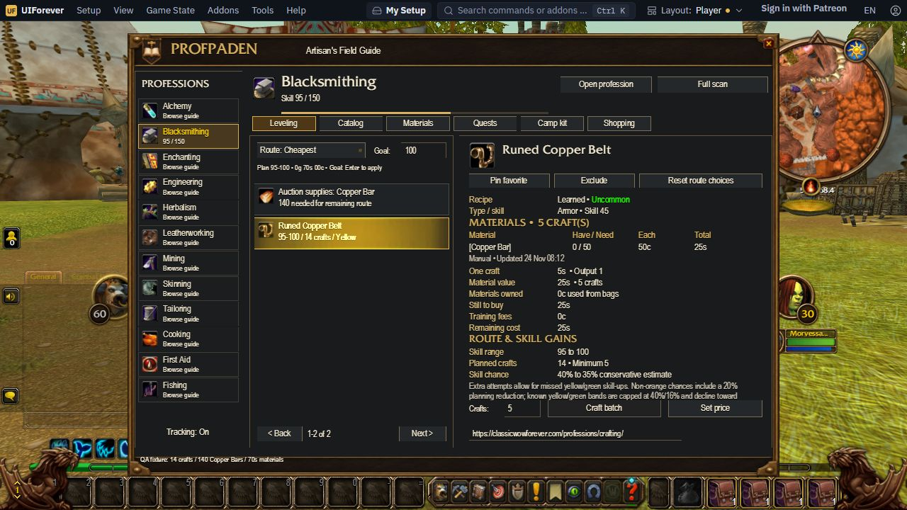
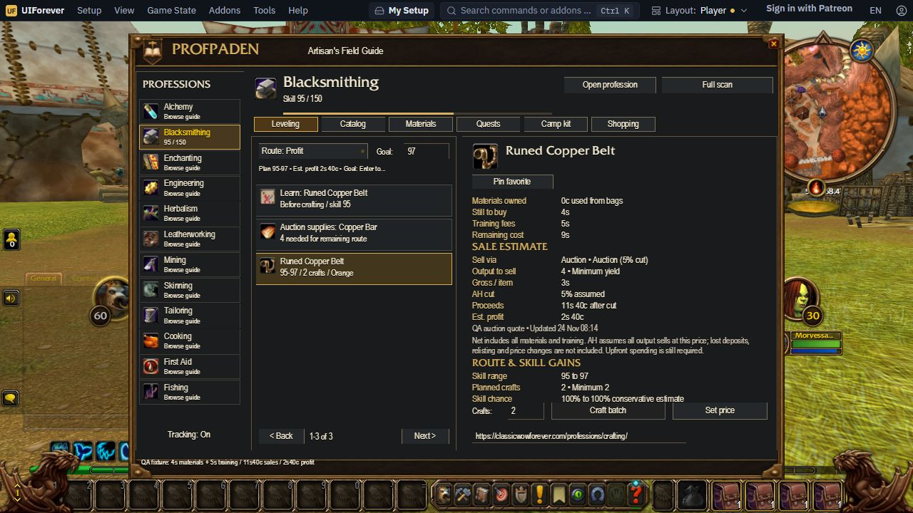

# Crafting guide arithmetic audit — November 24, 2026

ProfPaden **0.20.41-rc1**, local candidate based on `9ed0237f095763b2178496ae068b1156dd9097b3` (0.20.40-rc1). This task did not publish a GitHub release. The existing layout and controls were retained.

## Findings and repairs

| Area | Finding | Corrected behavior |
|---|---|---|
| Cheapest purchase quotes | Unlimited vendor supplies bypassed cheaper AH data. Purchase and sale freshness rules differed. | Compare valid AH and vendor quotes; preserve explicit manual input valuations, including zero. Reject negative/nonfinite values and unusable timestamps. |
| Price scan coverage | Intermediate conversion inputs, live-only recipes, and money-making outputs could be absent. | Include direct and recursive learned-conversion ingredients; include sellable outputs in profit/money modes. Recompute the scope when resuming. |
| Price refresh | Auctionator updates did not invalidate every displayed route estimate. | Invalidate the guide and sourcing caches, mark shopping calculations dirty, and refresh visible windows. Existing full-scan completion also rebuilds the fixed goal. |
| Multiple skill points | The route integrated chance at ranks skipped by a multi-point craft. | Evaluate chance only at reachable ranks, prevent impossible recipe handoffs, and align color stops with successful skill jumps. |
| Remaining attempts | Proportional scaling could understate the remaining crafts as skill-up chance declines. | Recalculate the expected attempts from the current rank. |
| Batch pricing | A single-item quote could qualify a large unpriced batch; separate steps could reuse the same limited vendor stock. | Requote combined route/leaf requirements; unknown quantities cannot win Cheapest as zero cost. Step allocations sum to the full route. |
| Training | Revisiting an unlearned recipe could charge its training fee again. | Charge each recipe's recorded training fee once on the selected path. |
| Margins and display | Details could attempt arithmetic on an unpriced batch, and incomplete Guided totals could appear complete. | Gate margins on the actual batch quote; label incomplete Guided totals as subtotals; reject invalid output yields/counts. |
| Saved plans | Previous quantities could survive changed math. | Increment planning model to 4 so saved shopping calculations rebuild while preserving settings and mail credit. |

## What the estimates mean

- **Cheapest** compares full material value plus training for accessible learned/recorded-trainer recipes. Bags reduce remaining spending, not the recipe's full economic cost. Explicit manual input prices override quotes; the money-making mode deliberately uses purchase quotes instead of manual valuations or owned stock.
- A fresh observed AH sample (up to 24 hours) takes precedence over historical summaries. After a successful Auctionator full scan, older observed samples are excluded. Otherwise valid Auctionator data up to seven days old, Auctioneer market estimates, and TSM `dbmarket` estimates are compared. Providers without comparable timestamps remain labelled estimates. This is coverage of relevant ingredients and available provider data, **not every live listing or guaranteed batch depth**.
- Vendor offers qualify only for quantities their recorded stock can cover. The planner does not split a purchase between a limited vendor and the AH. Unit estimates can therefore be conservative. Current availability and purchase totals still need review in Auctionator.
- Expected attempts are `ceil(sum(1 / chance_at_reachable_skill))`, with successful jumps of `numSkillUps`. Yellow/green probabilities are conservative planning assumptions, not measured server guarantees. A forecast of 14 crafts does not promise exactly five skill-ups; update/reassess as crafting proceeds.
- The craft button's immediate batch is bounded by the next color/goal reassessment point. It can show **5** while the complete yellow route forecasts **14** attempts. The guide/shopping material requirement is based on the forecast, not that immediate button limit.
- Profit uses minimum output yield, full materials, recorded training, and the selected AH cut (5% or 15%). Owned stock is not treated as free profit. It assumes the output sells at the estimate; deposits lost to failed/cancelled auctions, relisting, price changes, time costs, and sale likelihood are excluded. Input and output estimates are not executable buy/sell offers.
- The existing bounded route search keeps one best state per skill rank and chooses conversion branches greedily. This audit fixes the reproduced arithmetic errors; it does not establish a globally optimal solution for every inventory, conversion, training-state, or market-depth combination.

## Functional evidence

The initial 13-case suite reproduced **nine failures** in the old code. The corrected suite passes **16/16**, including three added edge cases. [Baseline](math-baseline.json), [corrected checks](math-checks.json).

| Suite | Passed |
|---|---:|
| New arithmetic fixtures | 16/16 |
| Profit | 14/14 |
| Money-making | 11/11 |
| Sourcing | 15/15 |
| Skill chances | 8/8 |
| Client behavior regression | 10/10 |
| Shopping | 22/22 |
| Shopping UI/workflow | 23/23 |
| Route stops | 21/21 |
| **Functional total** | **140/140** |
| Release packaging guards | 9/9 |

All **83 Lua files** in the package compile under Lua 5.1, and all **5,369 packaged files** match the reviewed manifest. The PadenCrates companion is unchanged. [Static report](static.json), [changed files](changed-files.json), [installation report](installation.json).

Numeric examples independently asserted:

- Skill 95→100, declining yellow chance: **14 crafts**, 10 bars/craft at 50c = **140 bars / 70s**; at skill 99 the remaining forecast is **3** attempts.
- Skill 100→103 with a three-point orange craft: **one craft**, even when it crosses a yellow boundary. No route can switch recipes at an intermediate rank the craft skips.
- Two crafts, 2 inputs/craft at 1s: **4s materials + 5s training = 9s cost**. Minimum output 2/craft at 3s, less 5% AH cut: **11s40c proceeds; 2s40c estimated profit**. The 15% cut is also tested.
- Combined branches and multiple route steps cannot each reuse the same limited-stock quote. Missing batch prices remain unknown.

Reproduction requires Python with `lupa.lua51`: run `tools/verify_guide_math.py`, the eight scripts under `tools/guide_math_regressions/`, and `tools/test_release_packaging.py` from this checkout. The NPC location fixture retained by one legacy regression is a historical fixture, not a new source-data audit.

Performance fixtures: 100 learned recipes across skill 1→300 took **4.771s**; 30 recipes with learned conversions across 1→150 took **0.466s** in this host's Lua runtime. These synthetic worst/broad-range fixtures are not live WoW benchmarks. Large plans can take several seconds. [Timing report](performance.json).

## Visual and simulator evidence

UIForever, Forever 1.60.1.70450, imported the exact final ZIP. Runtime assertions confirmed version 0.20.41-rc1/model 4 and both numeric examples above. Real recipe names/icons were used with **controlled test prices/skill data**; these screenshots are not live market claims. The fixture scripts are included here. Temporary fixture data, window scale, and positioning were restored afterwards.

The simulator ended with **0 addon errors and 0 missing APIs**. Two test-console mistakes (newline stripping and a nonexistent test field) were corrected; neither was a production addon exception. No live AH purchases, in-game skill-up sampling, hardware controller test, taint trace, or live-client acceptance was performed. No new interactive controls or API contracts were introduced. Target remains Forever Interface 16001; previously resolved source contract build 1.60.1.71037 / `734f065329cff4992835b01a84f210a297db91b6`.

## Package and installation

`ProfPaden-0.20.41-rc1-forever.zip`, SHA-256:

`26daa458b02cc3812a87cdaaa7852b3eac164243d989e504e1f91146d8c745cf`

Only the 12 reviewed ProfPaden files are installed, after checking each against the previous release and backing up both workspace and installed copies. Every ProfPaden manifest file is hash-checked afterwards. No SavedVariables, macros, user settings, or unrelated addons are reset. Reload the game UI to load the new code; use **Full scan** at the AH to refresh the quote basis before relying on a route.

Installation verification: **5,357/5,357 installed ProfPaden files match**, with 24 backup copies (12 per location). The workspace matches 5,356 files; its older local-only `THIRD_PARTY.md` is intentionally preserved. The initial all-workspace comparison stopped at that document after applying the patches; a separate complete comparison confirmed every installed file and every changed workspace file matches the candidate.
