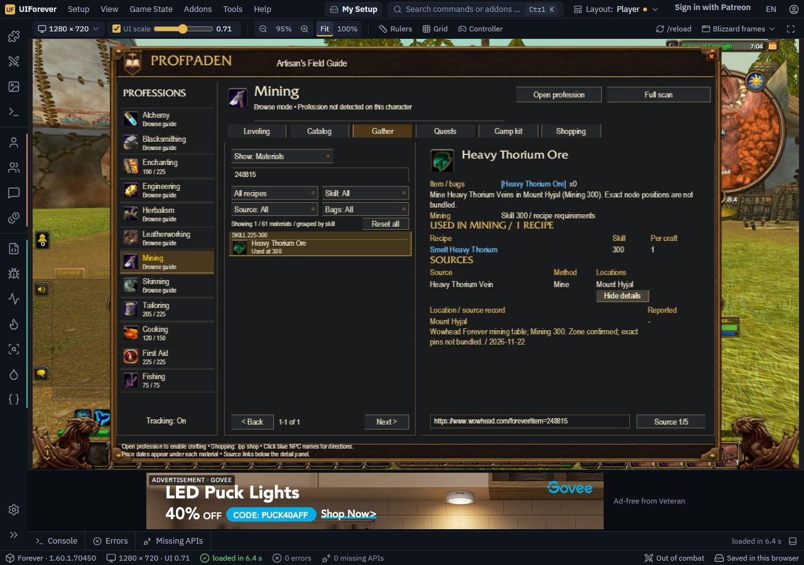
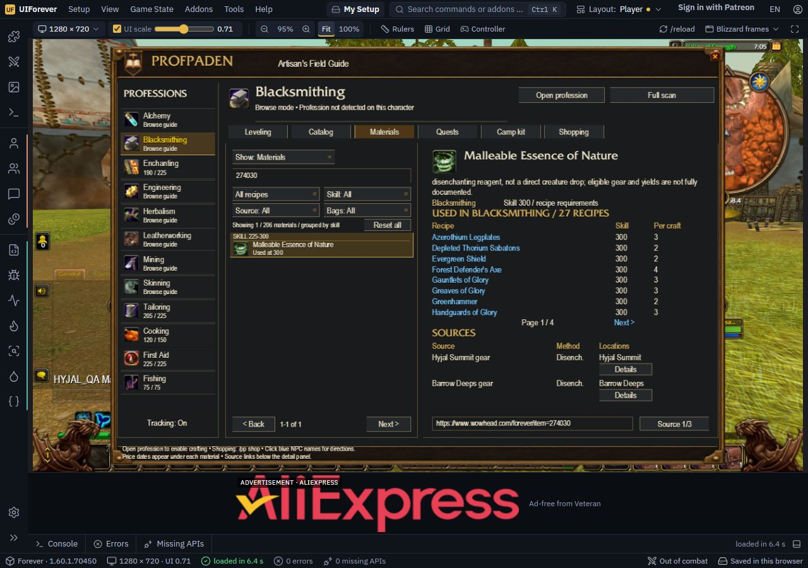
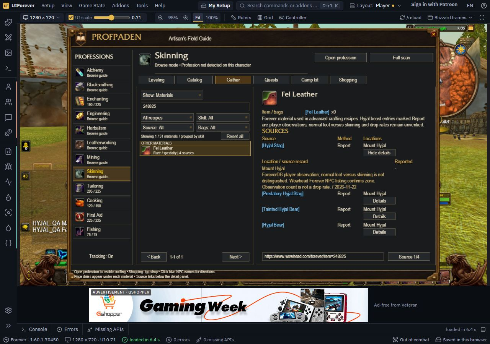
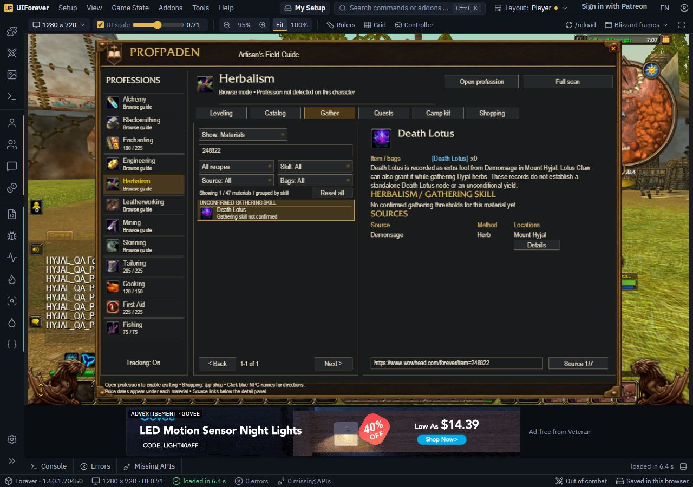

# High-level material source audit - 22 November 2026

ProfPaden 0.20.38-rc1, WoW Forever / Interface 16001. Data-only patch; no new API, UI control, controller behavior, settings, translation system or companion changes. Existing English catalog naming and accepted compact Sources display are retained. The existing Forever API contract is unchanged (Blizzard source revision 734f065329cff4992835b01a84f210a297db91b6; 1.60.1.71037). Simulator selection: UIForever, continuing the user's preference. Actual-client drops and controller input were not tested.

## Accepted records

21 materials, 31 reviewed source relationships, applied to 85 existing profession entries (131 links). See [reviewed facts](sources.json) for item/object/NPC IDs, URLs, evidence, sample counts and qualifications.

| Material group | Source and acquisition |
| --- | --- |
| Heavy Thorium Ore, Thorium Ore, Dense Stone, Pitchblende, Fel Crystal, Torbernite, Large Opal, Azerothian Diamond, Huge Emerald, Blue Sapphire | Heavy Thorium Vein, Mount Hyjal; Mining 300. Published Forever mining table. |
| Demonsage, Mountain Silversage, Stranglevine, Death Lotus | Demonsage nodes, Mount Hyjal; Herbalism 300. Recorded yields; equipment conditions are not established by the table. |
| Marefoil | Marefoil herb object, Mount Hyjal; Herbalism 300. Yield rate unpublished. |
| Dreamfoil and Mountain Silversage | Add Mount Hyjal to their existing object locations. |
| Stranglevine | Additional Dreamfoil and Mountain Silversage gathering relationships; both node types occur in Hyjal. |
| Malleable Essence of Nature | Disenchant equipment from Hyjal Summit or Barrow Deeps; not a direct boss drop. |
| Essence of Anarchy | Ezra Grimm (11058), Stratholme; loot. |
| Fel Leather, Rugged Leather | Hyjal Stag, Predatory Hyjal Stag, Hyjal Bear, Tainted Hyjal Bear: ForeverDB player observations, displayed as Report. |
| Fel Hide | Predatory Hyjal Stag: ForeverDB player observation, displayed as Report. |

The beast observations explicitly do not establish normal loot versus skinning. Counts are observations, not probabilities. Named beasts' zones were independently checked against Wowhead's Forever NPC list. Death Lotus's earlier standalone-node rumor is removed from active rows; the old Reddit records for four materials remain archived in `historicalSourceReports`. Lotus Claw's Hyjal gathering effect is documented separately from the sampled node yield.

## Boundaries and held records

No new coordinates, spawn masks, routes or zone centers are invented. Hyjal sources are searchable and shown by zone; this update does not add exact Hyjal map pins. Existing node data, overlays and zone selections are unchanged. The current sample percentages are intentionally not displayed as farming guarantees. Classic Era sample rows were excluded.

Hyjal Berries and Pristine Scale still lack a verified specific acquisition source. Felcloth's unnamed community NPC is held pending identity/location checks. Living Essence's new shrubbery observation lacks a checked location. Plaguebloom, Icecap, Black Lotus and the other inspected high-level essences/bars retain prior sources where no supported new Hyjal relationship was established. See held records in sources.json.

Evidence: Wowhead Forever indexed object/item/NPC records, plus bounded ForeverDB public observations downloaded on 22 November. Direct automated Wowhead HTML requests returned HTTP 403; no bypass was attempted. Search-index tables may lag gameplay. Fetch hashes and timestamps are recorded in fetch-provenance.json. The external provider's current client build was not independently established.

## Functional validation

- [Focused Lua 5.1 checks](checks.json): all 21 material details render, every reviewed source reaches each relevant profession, counts/search work, no duplicate rows, unchanged recipe and map data.
- [Full Gather integrity](gather-checks.json): 1,499 entries, 49,093 sources, 8,536 zone choices; 1,169,461 exported node coordinates checked. Eight checks passed, including all 313 repaired overlay unions.
- PadenCrates unchanged: 970 Lua 5.1 assertions passed. Nine release packaging guards passed.
- Package contains 5,367 runtime files under ProfPaden/ and PadenCrates/, with exact SHA-256 manifest verification and Forever WowUp metadata.

## Visual verification

Production ZIP loaded in UIForever Forever 1.60.1.70450, Interface 16001, at 1280x720 / UI scale 0.71. Checked fit views at 61%, 69% and 95% zoom. Named sources, wrapped notes, expandable details and long-panel scrolling were readable and functional. Final diagnostics: zero errors and zero missing APIs. One manual console typo called a nonexistent Show method; it was corrected to the existing slash command and was not an addon failure. See [simulator results](simulator.json). No simulator pass certifies live-game drops.

