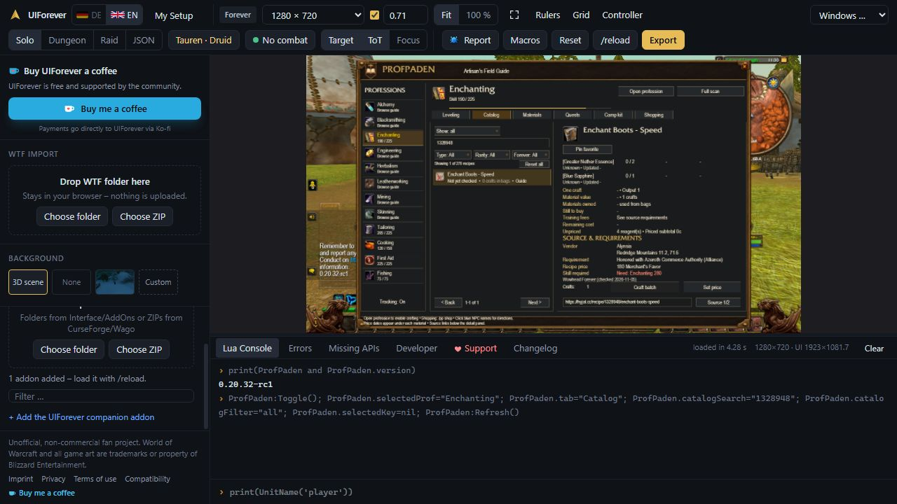
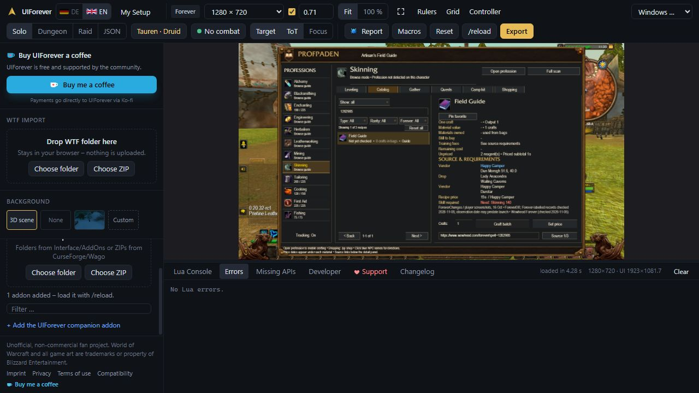
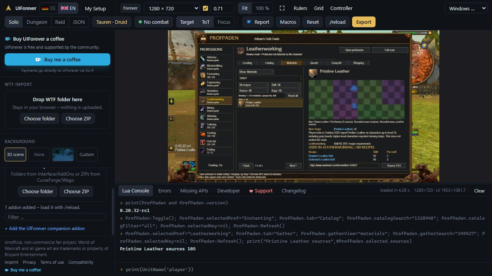

# Launch data coverage — November 5, 2026

Target: ProfPaden 0.20.32-rc1, WoW Forever, interface 16001. Baseline 392d715 matched the installed 0.20.31-rc1 runtime byte-for-byte before editing.

## Coverage

All 966 planned newer item IDs were checked: 54 materials and 912 recipe items. All 64 public ForeverDB source shards and 64 vendor shards were retrieved and joined against the inventory. Detailed Wowhead captures supplement those records, including six individually reviewed blueprint/formula acquisitions. 389 records have published relationships; 577 have no additional relationship in these snapshots. None remain pending. A blocked webpage is never treated as absence evidence.

The separate Hyjal scan covered 2,491 recipes. ForeverDB's current 2,492 records contain those existing recipes and the excluded deprecated Crystal Infused Bandage (30021). Recipe requirements and materials were preserved. This is a completed pass over these sources, not a claim that every live-world drop is known.

## Provenance

- [ForeverDB professions](https://foreverdb.net/professions): build 1.60.1.70790, extracted November 5, 2026.
- [ForeverDB methodology](https://foreverdb.net/about): separates observations and Classic fallback data. Only explicitly Forever-labelled new relationships were imported; observations may predate launch.
- [Wowhead Forever](https://www.wowhead.com/forever): item URLs accompany factual records. Published samples may include beta observations. Tables capped at 100 rows are not treated as exhaustive NPC coverage.

No player position is promoted to a guaranteed spawn coordinate. Existing points are reused only for the same entity ID. New NPCs without trusted coordinates remain location descriptions. Historical sources retain their original attribution.

`coverage.json` is the item ledger. `bulk-audit.json` records exact source URLs and accepted relationship counts. `provider-manifest.json` records snapshot hashes. `sources.json` contains normalized facts, not copied guides or tooltip prose. `tools/build_launch_sources.py` builds the additive runtime deterministically.

## Verification

Seven data checks cover preservation, reviewed acquisitions, material merges, NPC coordinates, idempotence, deterministic rebuild and all 966 item IDs. Ten offline functional checks cover examples, every 2,574 catalog and 1,499 material detail entries, and live recipe precedence.

UIForever imported the candidate ZIP and reported 0.20.32-rc1 on build 1.60.1.70450/interface 16001. Enchant, blueprint and leather details were inspected without Lua errors or listed missing APIs. The native-map checkerboard is a pre-existing simulator limitation. Witchcraft was unavailable; the user explicitly selected UIForever instead. No live-game acceptance is claimed.

The prior 1,273-check regression baseline was not rerun in full for this data-only patch. Current checks compare all affected recipe/map facts and exercise detail functions across the full catalog and atlas.

The [functional reference](preview.html) shows actual offline detail rows. JSON results provide functional evidence. Real-client reload, rendering and loot/trainer observations remain separate acceptance steps.
