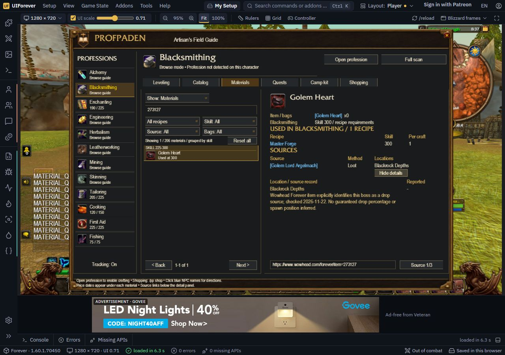
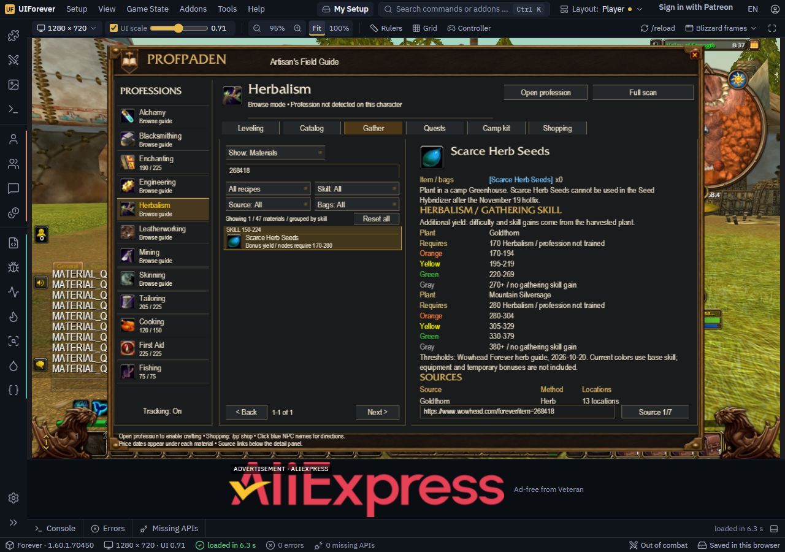
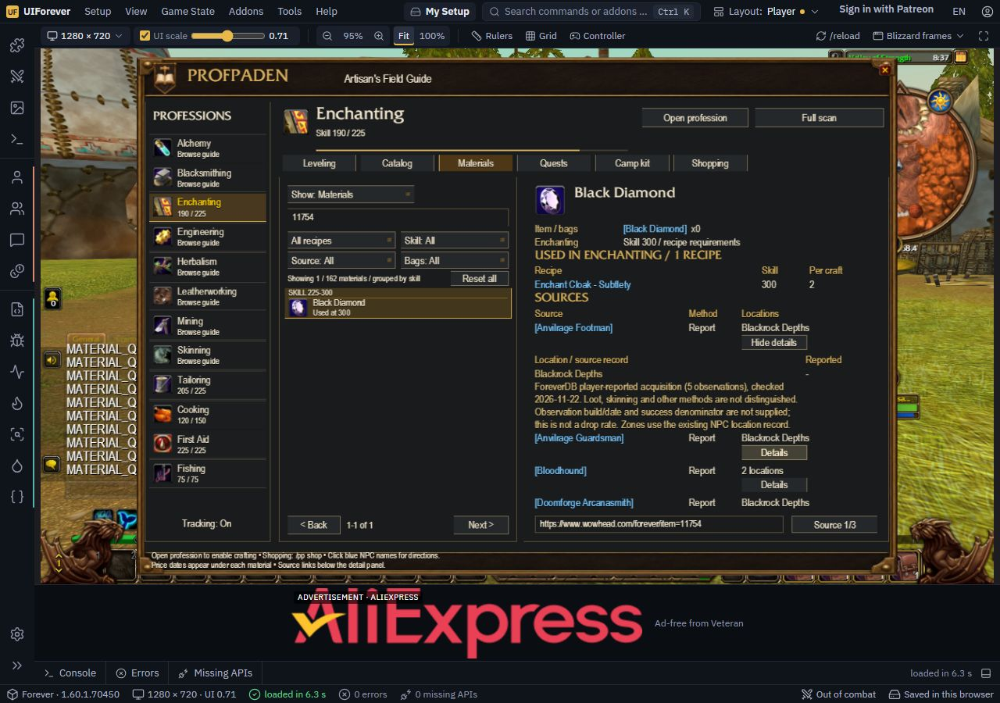
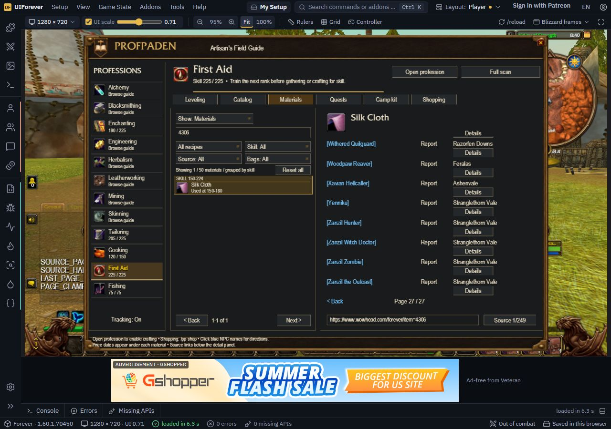

# Material-source audit — November 22, 2026

ProfPaden 0.20.39-rc1 audits all **627 unique materials** in the Gather catalog and adds **1,200 acquisition relationships across 75 materials**, applied to 278 profession entries. Twelve previously empty materials gain source records. This follows, and preserves, the 0.20.38 Hyjal update.

## Published source tables

| Material | Added source | Location |
| --- | --- | --- |
| [Golem Heart](https://www.wowhead.com/forever/item=273127) | Golem Lord Argelmach | Blackrock Depths |
| [Undeath Engine](https://www.wowhead.com/forever/item=273130) | Vectus | Scholomance |
| [Bottled Screams](https://www.wowhead.com/forever/item=273131) | Baroness Anastari | Stratholme |
| [Lich's Index Finger](https://www.wowhead.com/forever/item=273125) | Ras Frostwhisper | Scholomance |
| [Maker's Spark](https://www.wowhead.com/forever/item=273128) | Nanaya | [The Shaper's Terrace](https://www.wowhead.com/forever/quest=96088/in-demand-titan-relics) |
| Rosecap | [Liferoot](https://www.wowhead.com/forever/object=2041), [Goldthorn](https://www.wowhead.com/forever/object=2046), [Khadgar's Whisker](https://www.wowhead.com/forever/object=2043) | Node zones listed in source Details |
| Unusual Herb Seeds | Liferoot, Khadgar's Whisker | Node zones listed in source Details |
| Scarce Herb Seeds | Goldthorn, [Mountain Silversage](https://www.wowhead.com/forever/object=176586) | Node zones listed in source Details |
| [Frilled Lichen](https://www.wowhead.com/forever/item=249399/frilled-lichen) | Mister Graphed, item-specific Sold by table | Riverglades |

These are 5 boss drops, 7 herb-yield relationships and 1 vendor relationship. Gather samples are recorded in Details without guaranteed percentages. A node's zone list is not evidence of a separately measured yield rate in each zone. No new spawn coordinates are inferred. The Frilled Lichen item table corroborates its vendor listing; prices and stock should be checked at the vendor.

The Scarce Herb Seeds note now follows the [official November 19 hotfix](https://worldofwarcraft.blizzard.com/en-us/news/24315281/wow-forever-hotfixes-november-13-2026): Greenhouse planting remains available, but Seed Hybridizer use was removed. This supersedes the older item tooltip. Rosecap's vague older player report is archived outside the active source rows.

## Community acquisition reports

The other **1,187 relationships are labeled Report**, not verified loot or skinning. They cover cloth, leather and hides, ores and gems, stones, fish and cooking ingredients, feathers, Black Diamond, Volatile Rum and other materials.

Acceptance required a current Forever item record, a Forever-tagged acquisition observation, at least three recorded observations, and an exact NPC ID/name match with an existing location record. The three-observation threshold filters isolated reports; it does not establish statistical confidence. The provider does not supply observation build/date, independent-player counts or a success denominator. Details state these limits, and no observation count is converted into a percentage. Existing NPC locations are reused; player acquisition coordinates are not imported as spawn pins.

## Audit trail and held candidates

- [Catalog ledger](catalog-audit.json) accounts for all 627 materials, including unchanged entries. No accepted addition does not mean a material has no sources: crafting, vendors and other helper paths may already cover it.
- [Accepted records](sources.json) contain exact item/source identities, methods, zones, provenance and source URLs. [Summary](summary.json) supplies counts.
- [Dataset fingerprints](fetch-provenance.json) record all 129 successfully retrieved public ForeverDB item/source/vendor datasets. Raw provider snapshots and research caches are not packaged or published.
- Generic or unknown NPC/object names, unlocated NPCs, single/two-observation reports, legacy-only item records and ambiguous quest/crafting records were not imported by the broad report pass.
- Most Mister Graphed reagent stock remains held: beta news and provider observations alone conflict with the NPC page's limited current stock table. Only Frilled Lichen has an independently checked item-specific listing in this patch. Pristine Scale remains unresolved.
- Swollen Venom Sac reports remain held at one observation per creature. Cultivation copies of herbs are not silently treated as natural herb nodes. Classic Era rows are excluded from new Forever gather facts.

## Functional and visual verification

[Focused Lua 5.1 checks](checks.json) exercise every updated material through the actual addon UI code, preserve existing sources/recipes/map data, check source identity/search/counts, and prove repeat merges do not duplicate rows or search text. [Full Gather checks](gather-checks.json) cover 1,499 entries, 53,967 source records, 8,536 zone choices, 1,169,461 exported nodes and 313 repaired overlays. PadenCrates passes 970 assertions; nine release packaging guards pass. PadenCrates 0.2.1-rc1 is unchanged.

Simulator evidence and published package verification are recorded alongside this report. These checks establish data integration and UI behavior, not live-client drop rates or availability. The production target remains Forever Interface 16001; the simulator identifies itself as 1.60.1.70450.

Rebuild the data with `python tools/build_material_sources.py`, then run `tools/verify_material_sources.py` with the project's Lua 5.1 runtime available.

### Simulator results

The final production ZIP loaded as 0.20.39-rc1 with Auctionator 351 and unchanged PadenCrates 0.2.1-rc1. Twelve representative material selections passed, including all five bosses, all seed/Rosecap additions, Frilled Lichen, Black Diamond, Ironfeather and Silk Cloth. Mouse Details expansion, scrolling, compact locations and report provenance were visually checked.

Mouse activation of the existing source-page hyperlink did not advance in this simulator session; a console assertion recorded that failure. The registered hyperlink handler passed for page 2, last page 27 and out-of-range clamping. **Mouse pagination is not counted as passed.** No UI code changed. Final diagnostics show zero addon errors and zero missing APIs after clearing the recorded test assertion. Native map artwork remains checkerboard in this simulator. Actual-client hyperlink interaction, drop yields, persistence, combat and physical controller use were not tested.

See [simulator results](simulator-checks.json) and [console evidence](simulator-console.txt).

