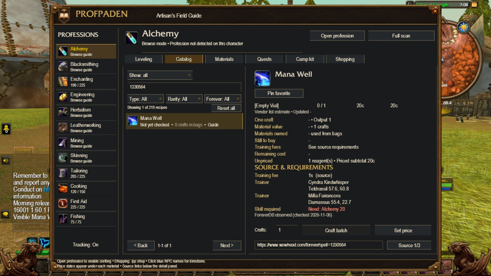

# Morning coverage pass — November 6, 2026

Target: WoW Forever / interface 16001. ProfPaden 0.20.33-rc1. Testing preference: UIForever; no UI redesign.

## Added

- 102 observed item acquisition relationships across 39 existing items: 69 creature loot sources, 30 vendor sources and three quest rewards.
- 119 observed trainer relationships across 87 recipes, shown in the existing acquisition panel. The player's own trainer visit, availability and fee stay first.
- Examples include Linen Cloth drops, Shadowgale Shriekling's observed Light Leather loot, Messana Crestwind's Coal/Strong Flux supplies on Zephras Isle, Darah's reagent-bag patterns, and additional Alchemy trainers.

All 141 public ForeverDB snapshots were refreshed: the item index, 12 profession files, 64 source shards and 64 vendor shards. [Retrieval times and hashes](provider-manifest.json) and the [reviewed relationships](sources.json) make this pass inspectable. The provider identifies client build **1.60.1.70790**, extracted November 6, on its [changelog](https://foreverdb.net/changelog). Retrieval is not the date an observation happened.

Compared with the published November 5 baseline, 129 new item-source candidates were not already covered by the same source entity. Yesterday evening's scan had 26; today's scan adds another 103 candidates. **27 are held**: 23 unnamed-creature relationships and four shared-object relationships (three Fishing Bobber records and a Battered Chest). Their IDs and evidence remain in the [review ledger](review.json); they are not presented as reliable new routes.

The item index lists 32 additional equipment items relative to the release baseline (six more than yesterday evening). They do not supply new profession recipes or materials. All 2,492 provider recipe entries were compared: no new recipe IDs; the previously excluded deprecated Crystal Infused Bandage remains excluded. The [profession review](profession-review.json) records changed metadata, including 121 `req` changes carrying `reqC`/`reqWas`, nine output-range annotations and four effect-text resolutions. These numeric/description changes require separate validation and are **not applied** by this source-only pass.

Only explicitly Forever-labelled provider observations are imported. Classic fallback observations are excluded. Existing NPC names/locations may resolve an observed entity ID and retain their prior evidence. No drop probabilities, vendor prices, new spawn points, trainer caps, recipe skill ranges or yields are inferred. In particular, an observed `drop` of leather is labelled **Loot**, never silently turned into a skinning yield. Existing sources, coordinates, optional addons and SavedVariables are retained.

## Verification

[Nine focused checks](data-tests.json) verify the full current data load order, every reviewed relationship, all 75 affected material entries and all new trainer acquisitions through the addon's actual detail renderer (including source pagination). They also verify live trainer precedence, preservation of recipe/terrain/NPC data, provenance, exclusions, repeat-load deduplication and deterministic regeneration.

The seven launch-data checks run against their historical module in isolation; the ten broad functional checks render all 2,574 catalog and 1,499 material entries with the current load order. The earlier 1,273-check baseline remains historical unless rerun explicitly. Offline checks and simulator evidence do not certify live game drops, trainer stock or gameplay.

Rebuild: `python tools/build_morning_sources.py`. Run checks with Python and `lupa.lua51` installed: `python tools/verify_morning_sources.py`, `python tools/verify_launch_sources.py`, `python tools/verify_launch_ui.py`. Final packaging: `python tools/build_release.py` verifies all runtime SHA-256 hashes and the installable ZIP.

The change uses existing UI controls and layout; new trainer records are rendered with the existing Trainer row and source attribution style.

## Simulator result

UIForever, November 6: build 1.60.1.70450 / interface 16001, Tauren Druid, Solo, 1280x720 at UI scale 0.71. The exact packaged addon was imported with only ProfPaden enabled. Mana Well's acquisition panel shows Cyndra Kindwhisper and Milla Fairancora with locations and the ForeverDB observation label. The existing detail scroll keeps those rows reachable. Version, 39-item ledger, 119 trainer relationships and Messana Crestwind's Strong Flux supply were asserted, including after reload. Hide/show passed. Errors reported No Lua errors; Missing APIs listed no entries. No in-game acceptance was run. The original simulator addon selection was restored.

[Loaded data assertions](simulator-checks.png) · [After reload](simulator-reload.png) · [Error panel](simulator-errors.png)

