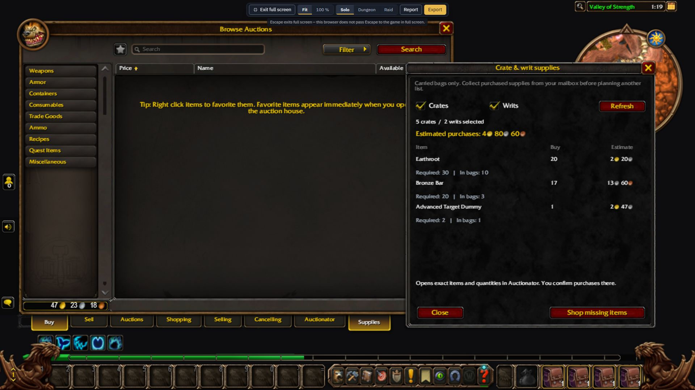
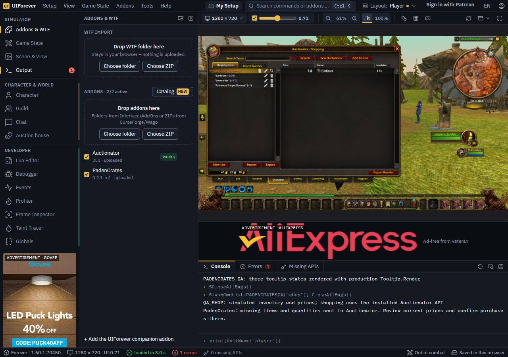

# 0.2.1-rc1 writ and auction-tab correction

- Replaced the red auction-house launcher with a compact Supplies tab using Auctionator's native tab template and padding. It remains a toggle for the existing preview and leaves the current auction display intact.
- Removed the shopping gate that rejected all recorded writ requirements when GetQuestObjectives returned nil/empty. Known catalog quantities now work immediately; loaded quantities override them.
- Ignore the quest objective for the carried writ itself, using its item link ID or complete localized name. Extra unrecognized item requirements still block misleading costs.
- QUEST_LOG_UPDATE refreshes the preview. Existing inventory aggregation, localized exact search, duplicate-list guard and purchase confirmation behavior remain.

## Evidence
970 Lua 5.1 assertions pass (700 engine/adapter/catalog, 91 runtime, 179 shopping), including all 150 writs with an empty quest cache, two-objective live quests, localized self-item recognition, shared inventory deduction and unrelated additional requirements. All 30 crate bundle lists and 150 writ quest/target mappings match the independent reference.

UIForever 1.60.1.70450 with actual Auctionator 351: synthetic owned bags/prices, production adapter deliberately receiving nil objectives. Five crates plus two Advanced Target Dummy writs produce shortages of 20 Earthroot, 17 Bronze Bars and 1 Advanced Target Dummy after deducting carried stock. Physical Supplies click opens preview; Close works; Shop missing items physically exports all three exact quantities into the real Auctionator shopping list. No purchases made. Screenshots: supplies-tab-writs-0.2.1.jpg and writ-export-0.2.1.jpg.

A mistyped simulator console command SCloseAllBags caused one console-only error; inspected and cleared. No addon errors or missing APIs were observed in these paths. Fullscreen browser input mapping was unreliable, so functional clicks were repeated in the normal browser view. Clean production reload verification recorded below.

## Source checks
- Same Forever pin 734f065329cff4992835b01a84f210a297db91b6 (1.60.1.71037). Native template definition saved in research/Blizzard_AuctionHouseTab.xml; same template/padding used by installed Auctionator 351 LibAHTab-1-0.
- Wowhead quest 94281 (Advanced Target Dummy) lists one writ and one dummy: https://www.wowhead.com/forever/quest=94281/craftsmans-writ-advanced-target-dummy
- Quest 94213 (Lesser Mana Potion) lists one writ and one potion: https://www.wowhead.com/forever/quest=94213/craftsmans-writ-lesser-mana-potion
- Quest 94237 (Crafted Solid Shot) lists one writ and 200 ammunition: https://www.wowhead.com/forever/quest=94237/craftsmans-writ-crafted-solid-shot
These spot checks support the existing catalog and the self-writ exclusion, not a claim that all live server quantities were reverified. Catalog retains its MIT attribution.

Actual-client purchases, secure fill and controller navigation remain NOT RUN. Existing saved settings and bag behavior preserved.

Clean production reload verified 0.2.1-rc1 with no QA fixture, zero errors and zero missing APIs.

Run `python -m pip install lupa` and `python tools/verify_padencrates.py` to repeat the 970 Lua checks. These use synthetic inventory; no game actions or purchases occur.

Bundled release validation: 9 packaging checks cover both-folder output, the prior single-addon format, bad tags, modified companion hashes, external dependency flags, mismatched companion versions and unsafe paths. The combined archive contains 5,366 manifest-verified files; PadenCrates runtime matches the tested 0.2.1-rc1 package byte-for-byte.
